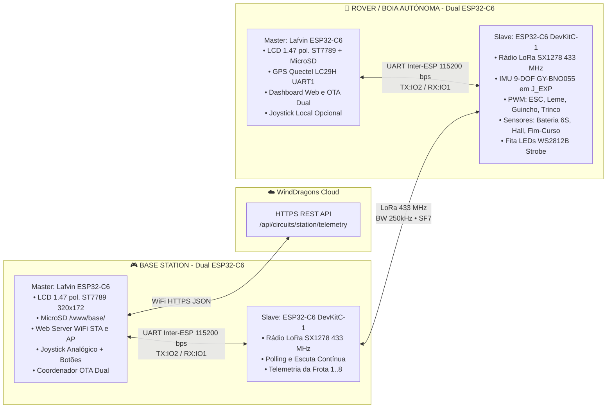
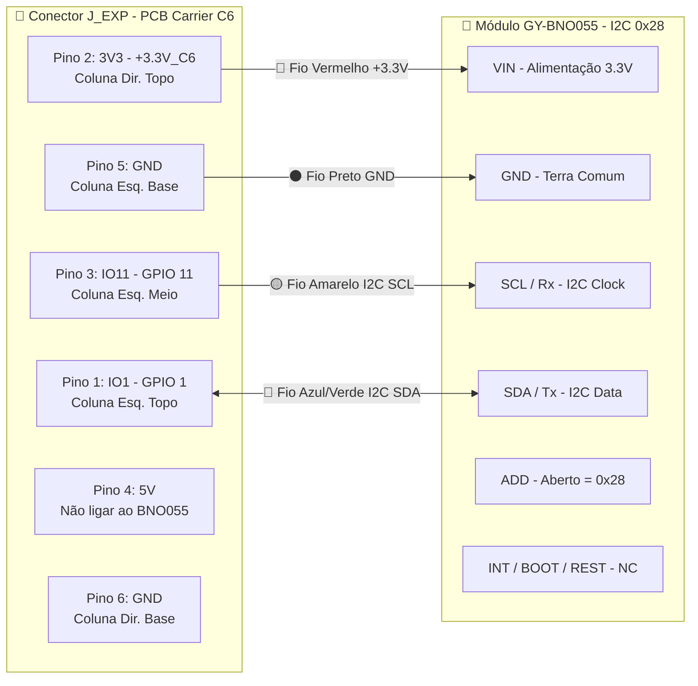
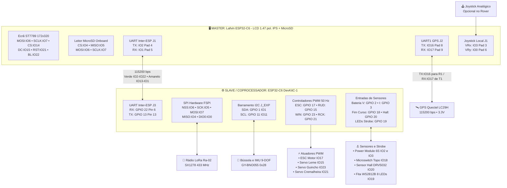
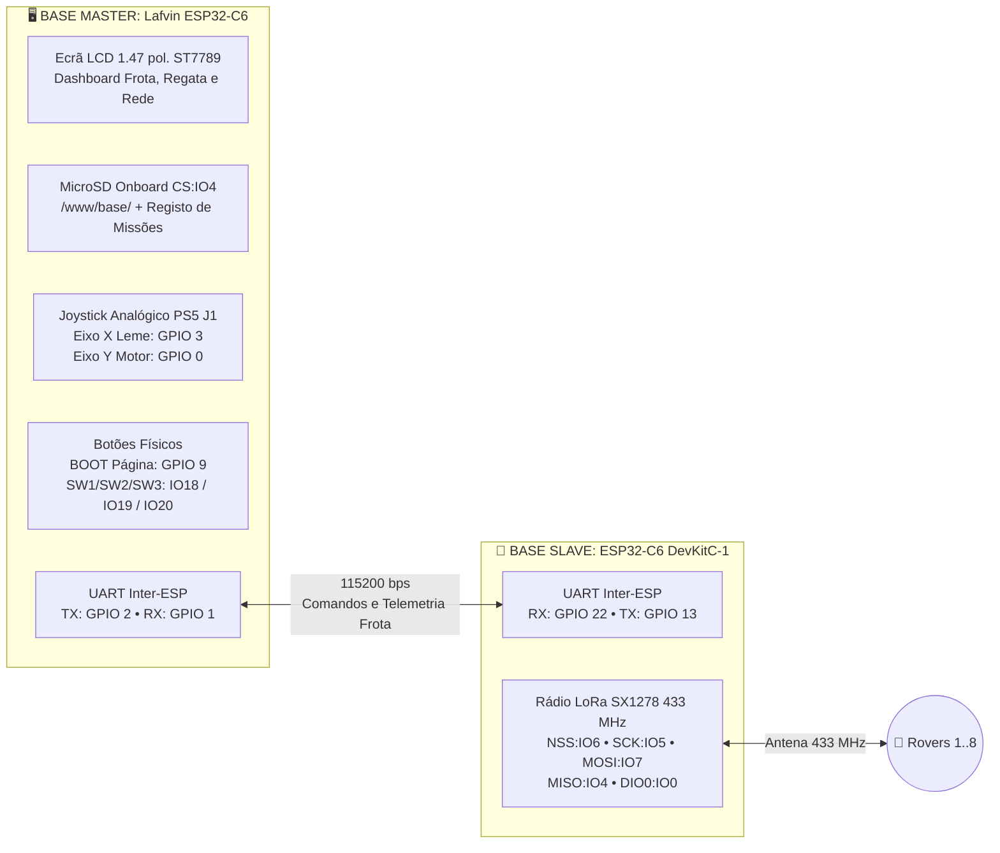

# WindDragons — Sistema de Telemetria e Controlo Náutico (Rover & Base Station)

Projeto de automação, navegação autónoma e telemetria para boias robóticas de regata (**Rovers**) e estação de comando com ecrã (**Base Station**), baseado na **Placa Carrier Universal Dual ESP32-C6** (**Master Lafvin LCD 1.47" IPS** + **Coprocessador ESP32-C6 DevKitC-1**).

---

## 🛰️ 1. Arquitetura Global do Sistema



---

## 🧭 2. Esquema de Ligação — Bússola & IMU 9-DOF (`GY-BNO055` em `J_EXP`)

O módulo **GY-BNO055** liga-se diretamente à ilha de expansão **`J_EXP` (2x03 pinos, passo 2.54 mm)** da PCB Carrier (ligada ao **Coprocessador ESP32-C6 DevKitC-1**).



### Disposição Física da Serigrafia `J_EXP` na PCB vs `GY-BNO055`

```text
       PCB CARRIER — ILHA J_EXP                     MÓDULO GY-BNO055
    ┌────────────────────────────┐               ┌────────────────────┐
    │     Col. Esq.    Col. Dir. │               │  [o] VIN     <────────── Pino 2 (3V3)
    │                            │               │  [o] GND     <────────── Pino 5 ou 6 (GND)
    │     [■] IO1      [●] 3V3   │ ──(Pinos 1,2) │  [o] SCL\Rx  <────────── Pino 3 (IO11)
    │     [●] IO11     [●] 5V    │ ──(Pinos 3,4) │  [o] SDA\Tx  <────────── Pino 1 (IO1)
    │     [●] GND      [●] GND   │ ──(Pinos 5,6) │  [o] ADD     (NC = 0x28)
    │         EXPANSION          │               │  [o] INT     (NC)
    └────────────────────────────┘               │  [o] BOOT    (NC)
                                                 │  [o] REST    (NC)
                                                 └────────────────────┘
```

| Pino no `GY-BNO055` | Pino em `J_EXP` (PCB) | GPIO ESP32-C6 (Slave) | Função / Notas |
| :--- | :--- | :--- | :--- |
| **`VIN`** | **`3V3`** (Pino 2 — Topo Direito) | `+3.3V_C6` | **Usar `3V3`** para manter níveis lógicos I2C a 3.3V puros |
| **`GND`** | **`GND`** (Pino 5 ou 6 — Base) | `GND` | Terra comum de referência |
| **`SCL \ Rx`** | **`IO11`** (Pino 3 — Meio Esquerdo) | `GPIO 11` | **I2C SCL** (Clock a 100 kHz com *clock stretching* ativo) |
| **`SDA \ Tx`** | **`IO1`** (Pino 1 — Topo Esquerdo) | `GPIO 1` | **I2C SDA** (Dados bidirecionais) |
| **`ADD` / `INT` / `BOOT` / `REST`** | *Não ligados (NC)* | — | Endereço I2C padrão `0x28` (deteção automática `0x28` / `0x29`) |

> [!IMPORTANT]
> **Pontes `PS0` e `PS1` no módulo GY-BNO055:** Certifique-se de que as duas pontes de solda **`PS0`** e **`PS1`** na placa azul do `GY-BNO055` estão **abertas (`LOW` / `0`)** para operar em modo **Standard I2C**.

---

## 🔌 3. Esquema Completo de Ligações — ROVER (Boia Autónoma)



### Mapa da Barra Inferior de Conectores da PCB Carrier (`Dual_ESP_Carrier`)

```text
┌────────────────────────────────────────────────────────────────────────────────────────┐
│  BARRA INFERIOR DE ATUADORES E SENSORES (Passo 2.54 mm — Esquerda para a Direita)      │
├───────┬───────┬───────┬───────┬────────┬────────┬─────────┬─────────┬──────────────────┤
│  ESC  │  RUD  │  WIN  │  RCK  │  STRB  │ J_BATT │ J_LIMIT │ J_WATER │       HALL       │
│ (3p)  │ (3p)  │ (3p)  │ (3p)  │  (3p)  │  (3p)  │  (2p)   │  (2p)   │       (3p)       │
├───────┼───────┼───────┼───────┼────────┼────────┼─────────┼─────────┼──────────────────┤
│ 1:GND │ 1:GND │ 1:GND │ 1:GND │ 1:GND  │ 1:GND  │ 1:GND   │ 1:GND   │ 1:GND (Preto)    │
│ 2:+5V │ 2:+5V │ 2:+5V │ 2:+5V │ 2:+5V  │ 2:IO3  │ 2:IO18  │ 2:IO15  │ 2:+3V3_C6 (Verm) │
│ 3:IO17│ 3:IO15│ 3:IO23│ 3:IO21│ 3:IO19 │ 3:IO2  │ (Switch)│ (Água)  │ 3:IO20 (Amarelo) │
└───────┴───────┴───────┴───────┴────────┴────────┴─────────┴─────────┴──────────────────┘
```

### Tabela Completa de Pinos do Rover

#### A. Comunicação Entre Placas (Master Lafvin $\leftrightarrow$ Slave DevKitC-1)
| Sinal | Pino Master (Lafvin `J1`) | Pino Slave (DevKitC-1 `J3`) | Cor de Referência | Função |
| :--- | :--- | :--- | :--- | :--- |
| **Master TX $\rightarrow$ Slave RX** | `GPIO 2` (`J1` Pad 4 — Serigrafia `2`) | `GPIO 22` (`J3` Pin 6) | 🟢 Verde | Comandos, GPS, Config e OTA para o C6 |
| **Slave TX $\rightarrow$ Master RX** | `GPIO 1` (`J1` Pad 5 — Serigrafia `1`) | `GPIO 13` (`J3` Pin 13) | 🟡 Amarelo | Telemetria LoRa, Bateria, Âncora e Estados |
| **Terra Comum** | `GND` (`J1` Pad 8) | `GND` (`J3` Pin 14) | ⚫ Preto | Referência comum obrigatória |

#### B. Periféricos Ligados ao Coprocessador ESP32-C6 DevKitC-1 (Rover)
| Periférico / Conector PCB | Pino do Módulo | GPIO DevKitC-1 | Notas Técnicas |
| :--- | :--- | :--- | :--- |
| **LoRa SX1278 (`J3_LORA`)** | `NSS` / `SCK` / `MOSI` / `MISO` / `DIO0` | `IO6` / `IO5` / `IO7` / `IO4` / `IO0` | Alimentado por `+3V3_C6` dedicado (433.0 MHz) |
| **Bússola `GY-BNO055` (`J_EXP`)** | `SDA` (`Pino 1`) / `SCL` (`Pino 3`) | `GPIO 1` (`SDA`) / `GPIO 11` (`SCL`) | Alimentado em `J_EXP Pino 2 (3V3)` e `Pino 5/6 (GND)` |
| **ESC Motor (`ESC`)** | Sinal PWM (Pino 3) | `GPIO 17` | 50 Hz (`1000..2000 µs`, Neutro `1500 µs`) |
| **Servo do Leme (`RUD`)** | Sinal PWM (Pino 3) | `GPIO 15` | 50 Hz proporcional (`-100%` a `+100%`) |
| **Guincho da Âncora (`WIN`)** | Sinal PWM (Pino 3) | `GPIO 23` | Rotação contínua (`1800 µs` sobe, `1200 µs` desce, `1500 µs` para) |
| **Servo Cremalheira (`RCK`)** | Sinal PWM (Pino 3) | `GPIO 21` | Trinco mecânico (`0°` travado / `90°` queda livre) |
| **LEDs WS2812B Strobe (`STRB`)**| `DIN` (Pino 3) + `+5V_SERVO` + `GND` | `GPIO 19` | Fita/Anel NeoPixel 8 LEDs RGB (Strobe / Navegação / Bateria) |
| **Fim de Curso Âncora (`J_LIMIT`)**| Contacto NA (Pino 1 `GND`, Pino 2 `Sinal`) | `GPIO 18` | `INPUT_PULLUP` — fecha ao `GND` quando a âncora toca no topo |
| **Sensor Hall Tambor (`HALL`)** | `GND` (1), `+3V3_C6` (2), `OUT` (3) | `GPIO 20` | Sensor TI **DRV5032** (`INPUT_PULLUP`, interrupção `FALLING`) |
| **Power Module 6S (`J_BATT`)** | `GND` (1), `CURR` (2), `VOLT` (3) | `GPIO 2` (V) / `GPIO 3` (I) | Leitura ADC LiPo 6S (divisor `10.803`, `27.32 A/V`) |

#### C. Periféricos Ligados ao Master Lafvin ESP32-C6 (Rover)
| Periférico / Conector PCB | Pino do Módulo | GPIO Lafvin | Notas Técnicas |
| :--- | :--- | :--- | :--- |
| **GPS Quectel LC29H (`J6`)** | `VCC` (`3V3`), `GND`, `R1` (RX), `T1` (TX) | `GPIO 16` (TX) / `GPIO 17` (RX) | UART1 a **115200 bps** (`R1` liga a `IO16`, `T1` liga a `IO17`) |
| **Ecrã LCD 1.47" ST7789** | Integrado na placa Lafvin | `IO6, IO7, IO14, IO15, IO21, IO22` | Resolução `320x172` Landscape |
| **Leitor MicroSD (TF Card)** | Integrado na placa Lafvin | `CS=IO4`, `MISO=IO5`, `MOSI=IO6`, `SCK=IO7` | Armazena `/www/rover/`, `/config.json` e `/telemetry.csv` |
| **Joystick Físico (`JOY1`)** | `3V3`, `GND`, `VRx`, `VRy` | `GPIO 3` (X) / `GPIO 0` (Y) | Ativável/desativável na página `/config` |

---

## 🎮 4. Esquema Completo de Ligações — BASE STATION (Comando de Frota)



---

## 🚀 5. Compilação e Pacotes de Atualização OTA Dual

Com o **PlatformIO** e **Python 3** instalados:

```bash
# 1. Gerar apenas os ficheiros Web comprimidos (.gz) para Rover e Base:
python3 scripts/build_web_assets.py

# 2. Compilar e empacotar o Firmware Completo do ROVER (C6 + Lafvin + Web):
python3 scripts/bundle_firmware.py
# -> Gera: dist/rover_firmware.zip

# 3. Compilar e empacotar o Firmware Completo da BASE STATION (C6 + Lafvin + Web):
python3 scripts/bundle_base_firmware.py
# -> Gera: dist/base_firmware.zip
```

> [!TIP]
> Para documentação detalhada de validação elétrica de bancada, separação dos domínios `+3V3` / `+3V3_C6` e especificações da régua destacável do sensor Hall DRV5032, consulte o ficheiro [`HARDWARE_PINOUT_MEMORY.md`](HARDWARE_PINOUT_MEMORY.md).
